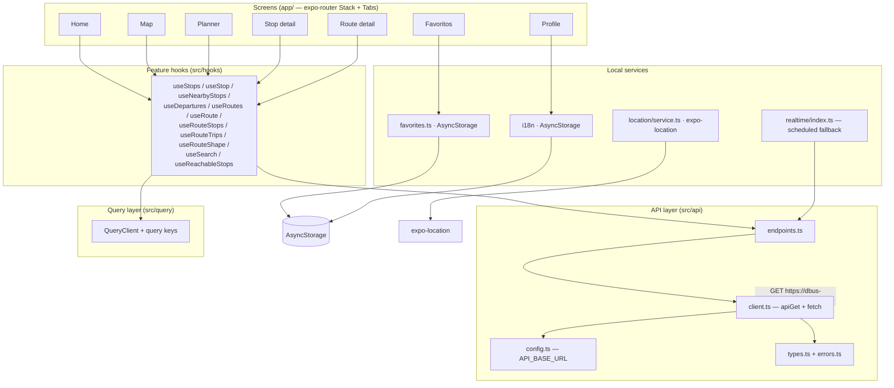
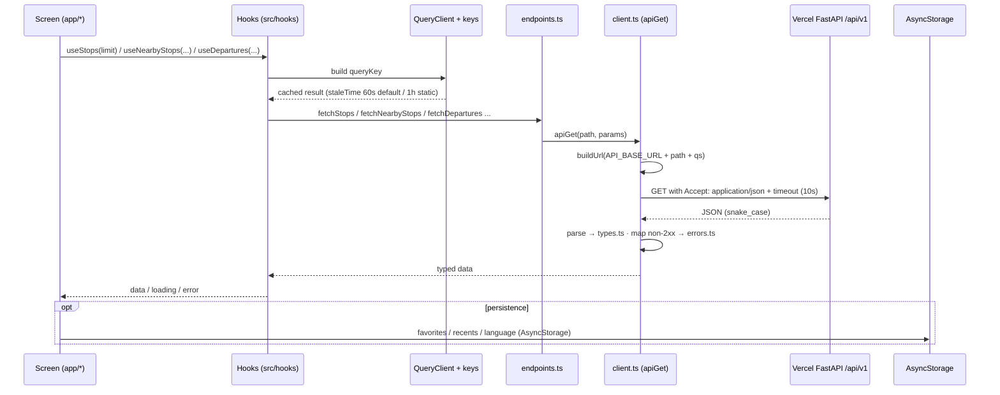

# DBus Mobile · V2

> **V2 (octubre 2026)** — copia de `dbus-data-prototype/mobile` que deja de depender de Expo Go
> y pasa a componentes nativos de iOS. La V1 original no se ha tocado.
>
> | Cambio | Dónde |
> |---|---|
> | Barra de pestañas nativa (UITabBarController, Liquid Glass en iOS 26, SF Symbols, se minimiza al hacer scroll) en lugar de `FloatingTabBar` | `app/(tabs)/_layout.tsx` |
> | Liquid Glass real (`expo-glass-effect`) en la hoja del mapa y superficies flotantes; `expo-blur` queda como respaldo en iOS < 26 | `src/design/surfaces/GlassSurface.tsx`, `src/components/UnifiedSurface.tsx` |
> | Modo oscuro: `userInterfaceStyle: "automatic"` y colores neutros adaptativos (`DynamicColorIOS`) | `app.json`, `src/design/tokens.ts`, `src/theme/glass.ts` |
> | Cabeceras nativas: chevron de vuelta del sistema, tinte de marca, títulos traducidos; `live/[routeId]` registrada | `app/_layout.tsx`, `src/i18n/*` |
> | Margen inferior del scroll adaptado a la barra nativa | `layout.bottomScroll` en `tokens.ts` |
>
> **Ya no funciona en Expo Go**: necesita una build propia (`.ipa`). `src/components/FloatingTabBar.tsx`
> queda sin usar (se conserva como referencia).


Expo (SDK 57) / React Native 0.86 / React 19 mobile frontend for the **DBus Donostia–San Sebastián** public-transport timetable. The app consumes the read-only static GTFS transport API hosted on Vercel and presents scheduled departures, a stop/route map, a single-line planner and locally persisted favorites.

This document describes **what exists in this folder today**. Where behaviour is partial, stubbed or not wired up, that is stated explicitly rather than described as a finished feature.

> Path: `DBus-App/DBus-app-V2` (V1: `dbus-data-prototype/mobile`)

---

## Rediseño 2.0 (estilo Apple)

La interfaz se ha rehecho con componentes nativos de iOS para que se comporte como una app de Apple:

| Área | Cómo está hecho |
|---|---|
| Navegación | `NativeTabs` (Inicio, Mapa, Viaje, Favoritos + pestaña de búsqueda del sistema) con una pila nativa por pestaña y títulos grandes (`src/ui/TabStack.tsx`). Las fichas de parada y línea se abren dentro de la pestaña actual (`app/(tabs)/(grupo)/stop`, `route`). |
| Colores | Colores semánticos de UIKit con `PlatformColor` (`src/ui/theme.ts`); el verde DBus es el único color de marca. |
| Listas | Listas agrupadas tipo Ajustes (`src/ui/List.tsx`), deslizar para borrar en Favoritos, tirar para actualizar. |
| Mapa | Puntos de parada solo al acercar el mapa, botón de ubicación en Liquid Glass y ficha de parada como hoja nativa con detents. |
| Viaje | Control segmentado nativo (`@expo/ui`), selector de fecha compacto y selector de paradas con barra de búsqueda nativa. El filtro de destinos alcanzables solo se aplica al destino. |
| Ajustes | Hoja modal desde el engranaje de Inicio: idioma (español, euskera, inglés) e información de los datos. |
| Icono | `assets/icon*.png` con variantes clara, oscura y tintada. |

## Short description

A native-style mobile app that shows DBus scheduled (GTFS) times. It finds the stop nearest to the device, shows upcoming departures, renders stops and lines on an interactive map, builds a single-line itinerary between two stops, and stores favourite stops/routes and recent searches on-device. **Realtime bus positions are not available** — the backend only serves the static timetable and every departure reports `realtime_status = "unavailable"`.

---

## Main features currently implemented

- **Nearest stop card** (Home): one-shot device-location request, then the closest stop and its next departures, with distance formatting.
- **Interactive map** (Map tab): full stop/route map via `react-native-maps`, auto-locates the device (with a Donostia fallback region), renders up to **500 stops** as markers, and shows a bottom place-card sheet for the selected stop.
- **Route detail**: stop sequence per direction, a schematic one-line "RouteStrip", route colouring, and favourite toggle.
- **Stop detail**: scheduled departures with countdown/clock labels and a "scheduled only" disclaimer.
- **Planner** (Plan tab): origin/destination stop pickers with **client-side** filtering, leave/arrive mode, date/time picker, and a single-line itinerary (suggested departures for lines serving the origin).
- **Favorites + recents**: stored in memory and persisted to `AsyncStorage` (`@dbus/favorites`); shown on Home and the Favoritos tab.
- **Localization**: Spanish (default) and English UI chrome via a small i18n context, language persisted to `AsyncStorage` (`@dbus/lang`).
- **Floating tab bar**: animated, glass (blur) bottom navigation with 5 tabs; hides itself while the map place-card is open.

## What is present but not fully wired

- **`app/live/[routeId].tsx`** exists and renders a route trip (stops + next departures at the head), but it is **not registered** in the root `app/_layout.tsx` `Stack` and no screen links to it. It is effectively unreachable from the UI.
- **`useSearch` hook** is implemented and exported, but no search **screen** consumes it. The Home search field currently navigates to the **Plan** tab, and the planner filters its in-memory stop list.
- **`LiveVehicles.tsx`** is a stub hook returning no vehicles and is **not imported by any screen**.
- **Profile tab** is largely static: name/email are hardcoded, and the Notifications / Accessibility / Avoid-transfers switches and Sign-out are non-persistent no-ops (the language switch works).

---

## Screens overview

Routes are file-based (expo-router). The root `app/_layout.tsx` registers `(tabs)`, `stops/[stopId]` and `routes/[routeId]`; `app/index.tsx` redirects `/` to `/(tabs)`.

| Route | Screen | Data used | Notes |
|---|---|---|---|
| `/(tabs)` → `index` | Home | `useNearbyStops`, `useDepartures`, favorites/recents | auto-location; greeting; nearest stop; search field (→ Plan) |
| `/(tabs)` → `map` | Map | `useStops(500)`, `useDepartures`, location | `react-native-maps`; 500-marker limit; bottom sheet |
| `/(tabs)` → `plan` | Planner | `useStops(500)`, `useDepartures`, `useReachableStops` | client-side stop filter; single-line itinerary |
| `/(tabs)` → `saved` | Favorites | `favorites.ts` store | list + remove stops/routes; empty CTA → Map |
| `/(tabs)` → `profile` | Profile | `useI18n` | language toggle; other controls are placeholders |
| `/stops/[stopId]` | Stop detail | `useStop`, `useDepartures` | scheduled departures; favourite; refresh |
| `/routes/[routeId]` | Route detail | `useRoute`, `useRouteStops` | direction grouping; RouteStrip; favourites |
| `/live/[routeId]` | Live trip | `useRoute`, `useRouteStops`, `useDepartures`, `realtime` | **file present, not registered/linked** |
---

## Tech stack

From `package.json`:

- **Runtime**: Expo `~57.0.16`, React `19.2.3`, React Native `0.86.3`, `react-native-web` `^0.21.2`
- **Routing**: `expo-router` `~57.0.17` (`Stack` + `Tabs`)
- **Data/state**: `@tanstack/react-query` `^5.101.4` (single `QueryClient`)
- **Map**: `react-native-maps` `1.27.2`
- **Persistence**: `@react-native-async-storage/async-storage` `2.2.0`
- **Location**: `expo-location` `~57.0.14`
- **Date/time**: `@react-native-community/datetimepicker` `9.1.0`
- **UI/look**: `expo-blur` (glass surfaces), `expo-haptics`, `react-native-safe-area-context`, `react-native-screens`, `react-native-sfsymbols` (system-symbol icons), `@expo/vector-icons`
- **Other Expo**: `expo-constants`, `expo-linking`, `expo-status-bar`
- **Tooling (dev)**: `babel-preset-expo`, `typescript` `~5.9.2`, `jest` `^29.7.0` + `jest-expo` `~57.0.x`, `@testing-library/react-native`, `@react-native/jest-preset`

---

## Architecture overview


---

## Folder structure

```text
mobile/
├── app/                         # expo-router file-based routes
│   ├── _layout.tsx              # root layout: I18nProvider + QueryProvider + Stack
│   ├── index.tsx                # redirect / -> /(tabs)
│   ├── (tabs)/                  # tab group (FloatingTabBar)
│   │   ├── _layout.tsx          # Tabs layout (5 tabs)
│   │   ├── index.tsx            # Home
│   │   ├── map.tsx              # Map
│   │   ├── plan.tsx             # Planner
│   │   ├── saved.tsx            # Favorites
│   │   └── profile.tsx          # Profile
│   ├── stops/[stopId].tsx       # Stop detail
│   ├── routes/[routeId].tsx     # Route detail
│   └── live/[routeId].tsx       # Live trip (present, not registered)
├── src/
│   ├── api/                     # API client, endpoints, types, errors, config
│   ├── components/              # UI kit (tab bar, badges, input, surfaces, icons…)
│   ├── design/                  # theme tokens, route colors, motion, haptics, squircle, surfaces
│   ├── hooks/index.ts           # feature hooks over TanStack Query
│   ├── i18n/                    # es (default) + en dictionaries + provider
│   ├── lib/                     # time + geo helpers
│   ├── location/                # one-shot location service + types
│   ├── query/                   # QueryClient, query keys, provider
│   ├── realtime/index.ts        # RealtimeProvider contract + scheduled fallback
│   └── favorites.ts             # in-memory + AsyncStorage favorites/recents store
├── tests/                       # jest tests (api, data, location, navigation, smoke)
├── app.json                     # Expo app config (name, ios/android ids, plugins)
├── babel.config.js
├── jest.config.js / jest.setup.js
├── tsconfig.json
├── package.json / package-lock.json
└── .npmrc / .gitignore
```

> **Note:** there is **no `assets/` directory** in this project today. No bundled static images/icons are used; icons come from the `react-native-sfsymbols` symbol set and `@expo/vector-icons`.

---

## Data flow



---

## API integration

- **Base URL** is centralised in `src/api/config.ts`:
  - Production default: `https://dbus-app.vercel.app/api/v1`
  - Override for development via `EXPO_PUBLIC_API_BASE_URL` (no such variable is currently committed anywhere — no `.env` exists).
- **Transport**: a single typed GET wrapper, `apiGet<T>()` in `src/api/client.ts`, built on the platform `fetch` with a 10 s timeout (`AbortController`), query-string building and error normalization.
- **Error model** (`src/api/errors.ts`): `ApiError` (with backend code + HTTP status), `NetworkError`, `DecodeError`, and `parseApiError`.
- **Models** (`src/api/types.ts`): TypeScript interfaces matching the backend contract (snake_case).
- **Endpoints** (`src/api/endpoints.ts`) actually used by screens: `/stops`, `/stops/{id}`, `/stops/nearby`, `/stops/{id}/departures`, `/routes`, `/routes/{id}`, `/routes/{id}/stops`. Also defined but **not consumed by any screen**: `/routes/{id}/trips`, `/routes/{id}/shape`, `/search`.

> The backend is a FastAPI service deployed on Vercel serving a read-only SQLite build of the official static GTFS. The mobile app contains no local server and no `localhost` API references.

---

## Local development setup

Prerequisites: Node.js + npm, and the **Expo Go** app on your device (same Wi-Fi as the machine). The project depends on Expo SDK 57 / React Native 0.86.

```powershell
# 1. Install dependencies (from the mobile/ folder)
npm install

# 2. Start the Expo dev server
npm start

# 3. Alternative targets
npm run android   # start on Android emulator/device
npm run ios       # start on iOS
npm run web       # start web build
```

Notes:
- The root `dbus-data-prototype/README.md` describes bringing up the FastAPI backend locally (`uvicorn api.app:app`) **for backend development only**. The mobile app itself does not target `localhost`; it points at the Vercel production URL by default. To point the app at a local backend during development, set `EXPO_PUBLIC_API_BASE_URL` to the local URL.
- A `.npmrc` in this folder sets `legacy-peer-deps=true`.

## Running with Expo Go

1. `npm start` (or `npx expo start`).
2. Open the Expo Go app on your phone and scan the QR code shown in the terminal.
3. The app requests location permission once it opens (Home / Map); if denied, the map falls back to the Donostia region and Home shows an "enable location" card.

## Build requirements

- Expo SDK `~57.0.16`, React Native `0.86.3`, React `19.2.3` (see `package.json`).
- Config lives in `app.json` (iOS/Android bundle identifiers, splash color, plugins incl. `expo-router`, `expo-location`, `datetimepicker`).
- Scripts available: `start`, `android`, `ios`, `web`, `lint` (`expo lint`), `test` (jest), `tsc` (`tsc --noEmit`).
- No production build/deploy script (e.g. EAS) is committed; distribution builds are not configured in this folder.

## Environment variables

| Variable | Purpose | Where |
|---|---|---|
| `EXPO_PUBLIC_API_BASE_URL` | Optional override of the API base URL. If unset, `API_BASE_URL` uses the Vercel production URL (`https://dbus-app.vercel.app/api/v1`). | `src/api/config.ts` |

`.env` / `.env.local` are git-ignored; none is currently present. `config.json` (generated by Expo locally) is also git-ignored.

---

## Testing

Tests use the `jest-expo` preset with `@testing-library/react-native`. `jest.setup.js` mocks `react-native-safe-area-context` and wraps renders in the i18n provider; AsyncStorage is mapped to the library mock.

```powershell
npm test        # run jest
npm run tsc     # type-check (tsc --noEmit)
npm run lint    # expo lint
```

Test files: `tests/api.test.ts` (client/errors), `tests/data.test.ts` (query keys + hooks), `tests/location.test.tsx` (Home nearest-stop flow), `tests/navigation.test.tsx` (stop/route detail), `tests/smoke.test.tsx` (Home render).

---

## Current limitations

- **No realtime.** The backend serves only scheduled GTFS. `src/realtime/index.ts` defines a `RealtimeProvider` contract but ships a `scheduledFallback`; every departure is `realtime_status = "unavailable"`. The `LiveVehicles` hook is a stub returning `[]` and is not used by any screen.
- **Live trip screen is unreachable** (file present, not registered in the route Stack, not linked).
- **No backend search in the UI.** `useSearch` exists but no screen uses it; the planner filters an in-memory list of up to 500 stops client-side.
- **500-stop map/planner ceiling** (backend `/stops` limit).
- **Planner is single-line only** — it composes reachable stops from the lines serving the origin and shows per-line departure timelines; there is no multi-leg journey planner.
- **Profile is partly static**: hardcoded name/email; Notifications / Accessibility / Avoid-transfers and Sign-out are non-functional placeholders; only the language switch and favorites persist.
- **Partially localized**: translations cover UI chrome, but several screens hardcode Spanish strings (e.g. Stop detail, Profile, Live).
- **No `assets/` folder** and no offline data caching beyond TanStack in-memory query cache (no on-disk request cache).

---

## Future roadmap

Anything beyond the current code is **not implemented**. Hooks left in the code for forward work:

- **Realtime provider** — the `RealtimeProvider` contract and `LiveVehicles` stub document how a validated live feed (SIRI/GTFS-RT) could be hot-swapped in; no live source is connected today.
- **Backend search screen** — `useSearch` is ready to consume a stop-search UI; it is not currently wired to any screen.
- **Route trips/shape** and **search** endpoints are defined in the API layer but not used by any screen.

---

## License

This folder contains **no `LICENSE` file**. Data used is DBus Donostia GTFS static data, subject to open-data reuse; see the licence notes in the parent prototype folder (`dbus-data-prototype/LICENSE_NOTES.md`) for the data-licence conditions. The app itself has no explicit license declared in the repository.